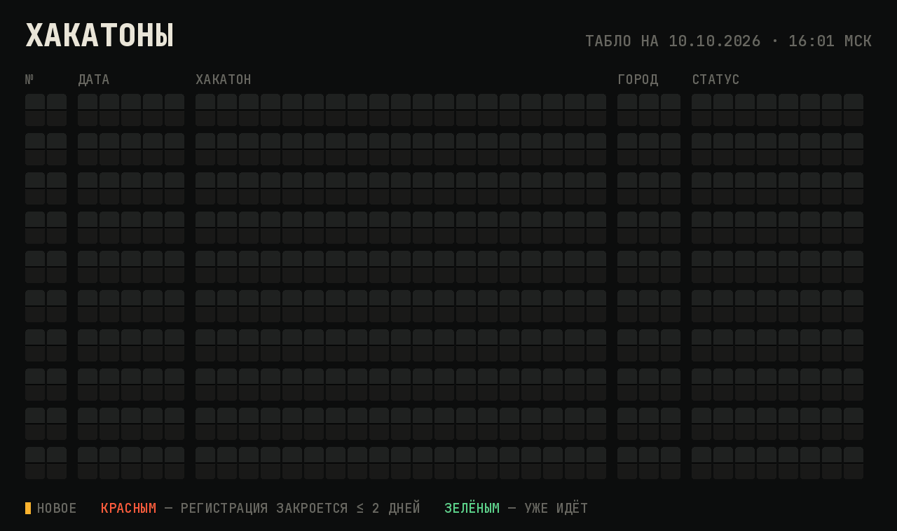
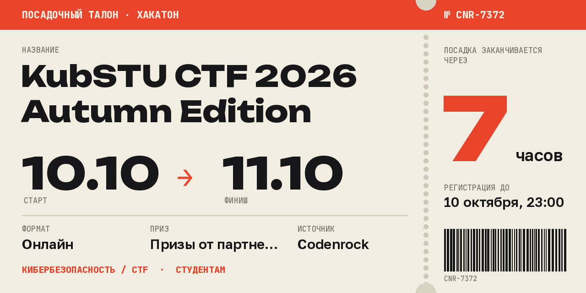

# hack-digest

Telegram-бот, который раз в N часов/дней/недель присылает дайджест ближайших хакатонов: анимированное табло вылетов, список со ссылками по срокам и «посадочный талон» на каждое событие. За выбранными хакатонами бот следит и напоминает о дедлайнах.

## Mini App «Hack Departures»

Главный режим бота. В чат раз в неделю приходит одно сообщение: картинка-табло, строка «143 рейса, горят 14» и кнопка «Открыть табло». Та же кнопка всегда висит рядом с полем ввода.

Кнопка открывает приложение внутри Telegram:
- **«Горит»** — карусель посадочных талонов, у которых регистрация закрывается в ближайшие 3 дня, с крупным обратным отсчётом;
- **табло вылетов** — все события по неделям и месяцам. Слева дата и что случится в этот день («СТАРТ», «РЕГ. ДО»), справа статус: ГОРИТ, ПОСАДКА (регистрация открыта) или ИДЁТ;
- **фильтры** — регион («Россия + онлайн», «Россия», «Весь мир») и темы (AI, CTF, продукт…). Они запоминаются в облаке Telegram;
- **талон события** — даты, формат, приз, описание, отсчёт до конца регистрации и кнопки «Регистрация и детали», «Следить» и «В календарь»;
- **«Мои»** — события, за которыми вы следите.

Приложение — это один статический файл `webapp/index.html` плюс `data.json` со снимком событий. Его бесплатно хостит GitHub Pages, а данные раз в 3 часа обновляет GitHub Actions (`.github/workflows/webapp.yml`), так что компьютер с ботом для этого не нужен.

**Как включить:**
1. В репозитории на GitHub откройте Settings → Pages → Source и выберите **GitHub Actions**.
2. Запустите workflow «Mini App» вручную (Actions → Mini App → Run workflow) или дождитесь ближайшего запуска. Адрес появится в Settings → Pages, обычно это `https://<логин>.github.io/hack-digest/`.
3. Впишите этот адрес в `.env` как `WEBAPP_URL=...` и перезапустите бота.

Без `WEBAPP_URL` бот работает по-старому: табло с номерами, карточки и текстовый дайджест.

Собрать снимок локально и посмотреть приложение в браузере:
```bash
python -m hackdigest.export webapp/data.json
cd webapp && python -m http.server 8000   # затем откройте http://localhost:8000
```

## Источники

**Сайты**

| Источник | Что там | Как читается |
|---|---|---|
| [хакатоны.рус](https://www.xn--80aa3anexr8c.xn--p1acf/) | главный российский агрегатор | JSON-лента Tilda |
| [Codenrock](https://codenrock.com/contests) | российские хакатоны, CTF, ML-соревнования | JSON API |
| [Leader-ID](https://leader-id.ru/events) | хакатоны «Точек кипения» и регионов | JSON API |
| [Devpost](https://devpost.com/hackathons) | международные хакатоны | JSON API |
| [MLH](https://www.mlh.com/) | студенческие хакатоны Major League Hacking | JSON в странице |
| [Devfolio](https://devfolio.co/hackathons) | международные хакатоны, много онлайн | JSON API |
| [Changellenge](https://changellenge.com/championships/) | студенческие хакатоны и IT-чемпионаты (бизнес-кейсы пропускаются) | HTML-карточки |
| [DoraHacks](https://dorahacks.io/hackathon) | международные хакатоны, много Web3 и AI | JSON API |
| [TAIKAI](https://taikai.network/hackathons) | европейские онлайн-хакатоны | GraphQL API |
| [lablab.ai](https://lablab.ai/ai-hackathons) | онлайн AI-хакатоны | JSON в странице (Next.js) |
| [CTFtime](https://ctftime.org/event/list/upcoming) | CTF со всего мира на 60 дней вперёд: с рейтингом, заметным числом команд или российские | JSON API |

**Telegram-каналы вузов, компаний и агрегаторов.** Бот читает публичную веб-версию `t.me/s/<канал>`, поэтому ему не нужны ни права админа, ни user-аккаунт. Из постов берутся только анонсы: в тексте должно быть слово «хакатон», CTF или геймджем, а также признаки приглашения (регистрация, призы, даты). Посты с итогами и рекапами отбрасываются. Даты проведения и дедлайн регистрации достаются из текста («15–17 ноября», «регистрация до 30 октября», «до 06.10»).

Стандартный список (`hackdigest/sources/telegram.py`):
- агрегаторы: хакатоны.рус, Hackathon list, Russian Hackers, Codenrock, ИНАЧЕ | Хакатоны, ЛЦТ, CTF News, Хакатон Осень (Ростов);
- вузы: ФКН ВШЭ, Бауманка, МИФИ, Иннополис, ФТИИ ИТМО, УрФУ, МФТИ, Центральный университет;
- компании: Changellenge, СберСтудент, VK Education, Т-Образование, Яндекс Образование, МТС True Tech, Альфа-Будущее;
- CTF-команды: KubCTF.

Ленту агрегаторов бот читает целиком. В каналах вузов и компаний анонсы хакатонов редкие, поэтому там он ищет посты по слову «хакатон», а в каналах CTF-команд — по слову «CTF» (`QUERIES` в `telegram.py`). Каждый чат может добавить свои каналы: `/channels add @username`.

Одно и то же событие часто есть на нескольких сайтах и в каналах. Бот склеивает дубли по названию и дополняет запись тем, чего в ней не хватало: например, датами и описанием с Codenrock для анонса с хакатоны.рус. Анонс из канала о событии, которое уже есть на сайтах, не показывается.

## Команды

| Команда | Что делает |
|---|---|
| `/start` | подписаться (или снова включить подписку) |
| `/digest` | дайджест прямо сейчас |
| `/board` | только табло; кнопки с номерами открывают карточки |
| `/tracked` | события, за которыми вы следите, и «всё в календарь» |
| `/vote` | опрос в группе: на какой хакатон идём (варианты — первые строки табло) |
| `/timeline` | картинка-таймлайн (диаграмма Ганта на 8 недель) |
| `/filter` | фильтр кнопками: регион, формат, темы, горизонт |
| `/sources` | включить или выключить сайты и каналы |
| `/channels` | список каналов; `add @a @b`, `del @a`, `reset` |
| `/interval 3d` | как часто присылать: `12h`, `3d`, `1w`, `2 дня`… (не меньше часа) |
| `/settings` | текущие настройки |
| `/stop` | отписаться |

## Тематика

У каждого хакатона определяется тематика в трёх разделах:

| Раздел | Темы |
|---|---|
| **Направление** — что разрабатывают | AI / ML, данные и аналитика, веб, мобильная разработка, кибербезопасность / CTF, геймдев, блокчейн / Web3, железо / IoT / роботы, алгоритмы и олимпиадное, продукт и бизнес, дизайн и UX (в т.ч. VR/AR), open source, квантовые технологии, свободная тема |
| **Сфера** — для какой отрасли | финтех и банки, медицина, образование, экология и энергетика, город и транспорт, промышленность, госсектор и общество, ритейл / туризм / сервисы, медиа и креатив, наука |
| **Для кого** | студентам, новичкам |

Тематика определяется по названию, тегам источника и описанию события. Словарь и правила лежат в `hackdigest/topics.py`. Совпадение в названии или тегах весит больше, чем упоминание в описании, а одно случайное слово в длинном тексте тему не добавляет. В дайджесте у события видны три самых выраженных направления и две сферы, а также одна фраза о задаче из описания. На талоне тематика набрана красной строкой под полями.

**Фильтр**
- *Регион:* «Россия + онлайн в мире» (по умолчанию: российские события и международные онлайн-хакатоны), «Россия» или «Весь мир».
- *Формат:* любой, онлайн или офлайн.
- *Тематика:* три подменю — направление, сфера, для кого. Внутри раздела подходит любая из отмеченных тем, между разделами нужны все сразу: «AI» + «медицина» значит AI-хакатоны в медицине.
- *Горизонт:* старт в пределах недели, месяца или 3 месяцев.

## Как выглядит дайджест



1. **Табло вылетов.** Десять ближайших событий в виде механического табло: буквы перелистываются и встают на места. Порядок — по ближайшему действию: старту или концу регистрации. Город записан кодом, как в аэропорту (МСК, СПБ, ОНЛ — онлайн). Статус: «ДО 14.10» — регистрация до этого дня (красным, если осталось не больше двух дней), «ИДЁТ» — уже началось. Жёлтая метка слева — событие, которого не было в прошлом дайджесте. Под табло кнопки 1–10, в группах ещё «Голосовать: куда идём».
2. **Текст со ссылками на страницы событий.** У каждого события указаны даты, формат, источник, приз, дедлайн регистрации, тематика, одна фраза о задаче и ссылка «карточка». Секции:
   - «Горит» — регистрация закрывается в ближайшие 3 дня, всегда первой;
   - «Ближайшие 7 дней», «В ближайший месяц»;
   - «Уже идут, регистрация открыта» и «Позже» (свёрнуты);
   - «Анонсы из Telegram-каналов».

   В каждой секции подробно показаны первые `SECTION_LIMIT` событий, остальные — по строке в раскрывающемся списке, так что ничего не теряется. Если какой-то сайт не ответил, внизу об этом написано.

### Карточка события



Открывается кнопкой с номером под табло или ссылкой «карточка» в тексте. Талон: название, даты, формат, приз, источник, тематика и отрывной корешок с обратным отсчётом до конца регистрации («посадка заканчивается»). Когда регистрация закрыта, корешок гаснет и на нём стоит штамп «ЗАКРЫТО». В подписи — организатор, число участников (если источник его сообщает) и описание. Кнопки:
- «Регистрация и детали» — страница события;
- «Следить и напоминать» — бот напишет за 3 дня и за день до конца регистрации, накануне старта, а также если у события сдвинутся даты или сменится формат;
- «В календарь» — файл `.ics` с напоминанием о регистрации за сутки.

Старая картинка-таймлайн доступна по `/timeline`.

Настройки хранятся отдельно для каждого чата, бот работает и в личке, и в группах.

## Запуск

**Локально (Python 3.11+), проще всего:**
```bash
python3 -m venv .venv && source .venv/bin/activate
pip install -r requirements.txt
python3 -m hackdigest.setup   # спросит токен от @BotFather, проверит его и запишет .env
python3 -m hackdigest.bot
```
Мастер настройки сам подставит адрес Mini App из адреса репозитория на GitHub. Бот читает `.env` при запуске сам, а значения из файла важнее переменных, оставшихся в терминале. Если токен неверный, бот так и напишет, без длинной трассировки. В следующий раз хватит двух команд: `source .venv/bin/activate` и `python3 -m hackdigest.bot`.

**Через Docker:** создайте `.env` мастером (как выше) или вручную из `.env.example` и запустите:
```bash
docker compose up -d --build
```

## Переменные окружения

| Переменная | По умолчанию | Описание |
|---|---|---|
| `BOT_TOKEN` | — | токен бота (обязательно) |
| `WEBAPP_URL` | — | адрес Mini App на GitHub Pages; если задан, дайджест — это табло и кнопка |
| `DEFAULT_INTERVAL` | `7d` | интервал для новых подписчиков |
| `DEFAULT_SOURCES` | все | источники для новых подписчиков |
| `DEFAULT_CHANNELS` | встроенный список | каналы для новых подписчиков |
| `SECTION_LIMIT` | `6` | сколько событий показывать в секции подробно; остальные — по строке в раскрывающемся списке |
| `DB_PATH` | `hackdigest.db` | путь к SQLite-базе |

## Как устроено

- `hackdigest/sources/`: по модулю на каждый источник. Ответы кэшируются на 30 минут. Новый сайт подключается так: модуль с функцией `async fetch(session) -> list[Hackathon]` и запись в `SOURCES`.
- `hackdigest/sources/telegram.py`: чтение каналов и эвристика «это анонс». `hackdigest/dates.py`: извлечение дат из текста.
- `hackdigest/topics.py`: словарь тематик и классификатор. `hackdigest/filters.py`: фильтры. `hackdigest/digest.py`: отбор, склейка дублей, текст дайджеста. `hackdigest/cards.py`: подпись карточки, `.ics`, напоминания. `hackdigest/render/`: табло (PNG и GIF) и талон на Pillow; шрифты Unbounded, Golos Text и JetBrains Mono лежат в `hackdigest/fonts/` (лицензия OFL). `hackdigest/timeline.py`: картинка-таймлайн.
- `hackdigest/storage.py`: SQLite, где хранятся подписки, фильтры, каналы, уже показанные события, последние данные о событиях (для карточек), слежение и отправленные напоминания. Старые базы мигрируются автоматически.
- `hackdigest/bot.py`: команды на aiogram 3 и планировщик, который раз в минуту отправляет дайджест чатам, у которых подошло время.

## Тесты

```bash
pip install -r requirements-dev.txt
pytest
```
