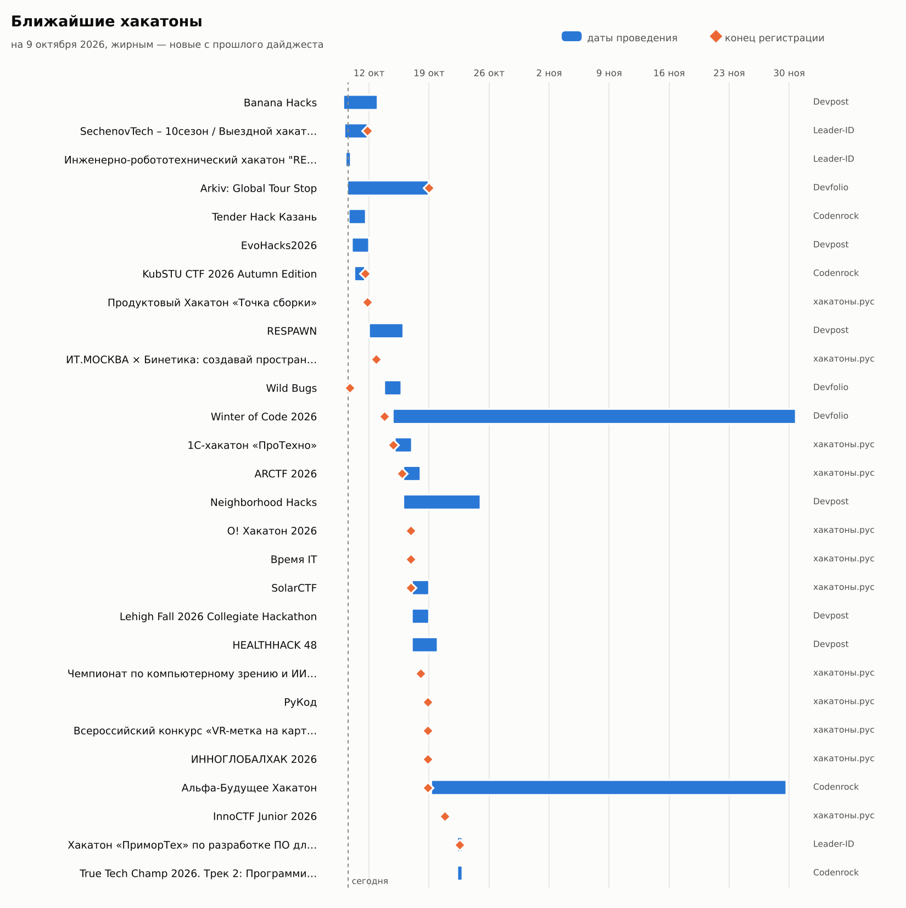

# hack-digest

Telegram-бот, который раз в N часов/дней/недель присылает дайджест ближайших хакатонов: картинку-таймлайн и список со ссылками, разбитый по срокам.

## Источники

**Сайты**

| Источник | Что там | Как читается |
|---|---|---|
| [хакатоны.рус](https://www.xn--80aa3anexr8c.xn--p1acf/) | главный российский агрегатор | JSON-лента Tilda |
| [Codenrock](https://codenrock.com/contests) | российские хакатоны, CTF, ML-соревнования | JSON API |
| [Leader-ID](https://leader-id.ru/events) | хакатоны «Точек кипения» и регионов | JSON API |
| [Devpost](https://devpost.com/hackathons) | международные хакатоны | JSON API |
| [MLH](https://www.mlh.com/) | студенческие хакатоны Major League Hacking | JSON в странице |
| [Devfolio](https://devfolio.co/hackathons) | международные хакатоны, много онлайн | JSON API |

**Telegram-каналы вузов, компаний и агрегаторов.** Бот читает публичную веб-версию `t.me/s/<канал>`, поэтому ему не нужны ни права админа, ни user-аккаунт. Из постов берутся только анонсы: в тексте должно быть слово «хакатон», CTF или геймджем, а также признаки приглашения (регистрация, призы, даты). Посты с итогами и рекапами отбрасываются. Даты проведения и дедлайн регистрации достаются из текста («15–17 ноября», «регистрация до 30 октября», «до 06.10»).

Стандартный список (`hackdigest/sources/telegram.py`):
- агрегаторы: хакатоны.рус, Hackathon list, Russian Hackers, Codenrock, ИНАЧЕ | Хакатоны, ЛЦТ;
- вузы: ФКН ВШЭ, Бауманка, МИФИ, Иннополис, ФТИИ ИТМО, УрФУ, МФТИ, Центральный университет;
- компании: Changellenge, СберСтудент, VK Education, Т-Образование, Яндекс Образование, МТС True Tech, Альфа-Будущее.

Ленту агрегаторов бот читает целиком. В каналах вузов и компаний анонсы хакатонов редкие, поэтому там он ищет посты по слову «хакатон». Каждый чат может добавить свои каналы: `/channels add @username`.

Одно и то же событие часто есть на нескольких сайтах и в каналах. Бот склеивает дубли по названию, а анонс из канала о событии, которое уже есть на сайтах, не показывает.

## Команды

| Команда | Что делает |
|---|---|
| `/start` | подписаться (или снова включить подписку) |
| `/digest` | дайджест прямо сейчас |
| `/timeline` | только картинка-таймлайн |
| `/filter` | фильтр кнопками: регион, формат, темы, горизонт |
| `/sources` | включить или выключить сайты и каналы |
| `/channels` | список каналов; `add @a @b`, `del @a`, `reset` |
| `/interval 3d` | как часто присылать: `12h`, `3d`, `1w`, `2 дня`… (не меньше часа) |
| `/settings` | текущие настройки |
| `/stop` | отписаться |

**Фильтр**
- *Регион:* «Россия + онлайн в мире» (по умолчанию: российские события и международные онлайн-хакатоны), «Россия» или «Весь мир».
- *Формат:* любой, онлайн или офлайн.
- *Темы:* AI / ML, Web, Mobile, безопасность / CTF, финтех, геймдев, Web3, железо / IoT, данные, социальные и эко. Тема определяется по тегам источника и названию.
- *Горизонт:* старт в пределах недели, месяца или 3 месяцев.

## Как выглядит дайджест



1. **Картинка-таймлайн.** Полосой показаны даты проведения, ромбом — конец регистрации, жирным выделены события, которых не было в прошлом дайджесте.
2. **Текст со ссылками на страницы событий.** Он разбит на секции: «Ближайшие 7 дней», «В ближайший месяц», «Уже идут, регистрация открыта», «Позже», «Анонсы из Telegram-каналов». Две секции в середине свёрнуты и раскрываются по нажатию. Внизу ссылки на полные списки источников.

Настройки хранятся отдельно для каждого чата, бот работает и в личке, и в группах.

## Запуск

1. Создайте бота у [@BotFather](https://t.me/BotFather) и получите токен.
2. `cp .env.example .env` и впишите `BOT_TOKEN`.

**Через Docker:**
```bash
docker compose up -d --build
```

**Локально (Python 3.11+):**
```bash
python -m venv .venv && . .venv/bin/activate
pip install -r requirements.txt
export $(grep -v '^#' .env | xargs) DB_PATH=hackdigest.db
python -m hackdigest.bot
```

## Переменные окружения

| Переменная | По умолчанию | Описание |
|---|---|---|
| `BOT_TOKEN` | — | токен бота (обязательно) |
| `DEFAULT_INTERVAL` | `7d` | интервал для новых подписчиков |
| `DEFAULT_SOURCES` | все | источники для новых подписчиков |
| `DEFAULT_CHANNELS` | встроенный список | каналы для новых подписчиков |
| `SECTION_LIMIT` | `10` | сколько событий показывать в секции, остальные — «и ещё N» |
| `DB_PATH` | `hackdigest.db` | путь к SQLite-базе |

## Как устроено

- `hackdigest/sources/`: по модулю на каждый источник. Ответы кэшируются на 30 минут. Новый сайт подключается так: модуль с функцией `async fetch(session) -> list[Hackathon]` и запись в `SOURCES`.
- `hackdigest/sources/telegram.py`: чтение каналов и эвристика «это анонс». `hackdigest/dates.py`: извлечение дат из текста.
- `hackdigest/filters.py`: темы и фильтры. `hackdigest/digest.py`: отбор, склейка дублей, текст дайджеста. `hackdigest/timeline.py`: картинка.
- `hackdigest/storage.py`: SQLite, где хранятся подписки, фильтры, каналы и уже показанные события. Старые базы мигрируются автоматически.
- `hackdigest/bot.py`: команды на aiogram 3 и планировщик, который раз в минуту отправляет дайджест чатам, у которых подошло время.

## Тесты

```bash
pip install -r requirements-dev.txt
pytest
```
